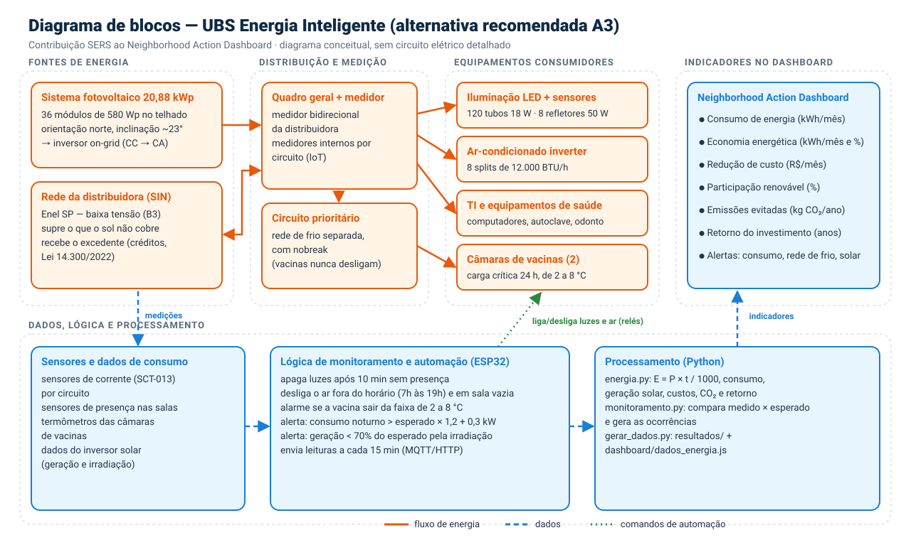
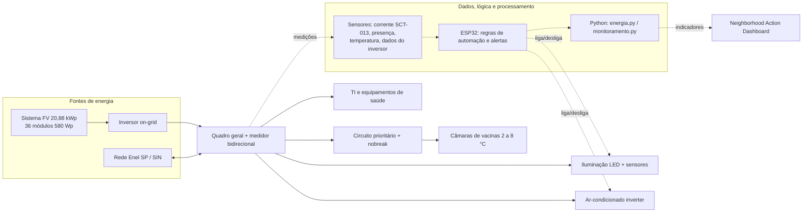

# UBS Energia Inteligente — Contribuição SERS ao Neighborhood Action Dashboard

**Global Solution 2026.2 · CitizenTech · Ciência da Computação (1CC)**
**Disciplina:** Soluções em Energias Renováveis e Sustentáveis (SERS)

> Este repositório traz **a contribuição de SERS** ao projeto integrador *Neighborhood Action Dashboard*: diagnóstico energético de uma Unidade Básica de Saúde (UBS), comparação de alternativas com fonte renovável, diagrama da solução e indicadores integrados ao dashboard. O grupo também desenvolveu, em Python, o *Monitor de Espera nas UBS*, outra contribuição para o mesmo dashboard.

## Integrantes

| Nome completo | RM |
|---|---|
| Nicolas Santos Assunção | 575154 |
| Larissa Fernandes | 574592 |

**Vídeo técnico (YouTube, não listado):** _colar o link aqui_
**Dashboard online (GitHub Pages):** https://nicolasassuncaoo.github.io/gs-2026-2-sers-ubs-energia/dashboard/

---

## Sumário
1. [Diagnóstico do problema](#1-diagnóstico-do-problema)
2. [Análise do consumo energético](#2-análise-do-consumo-energético)
3. [Comparação das alternativas](#3-comparação-das-alternativas)
4. [Diagrama da solução](#4-diagrama-da-solução)
5. [Indicadores de eficiência e sustentabilidade](#5-indicadores-de-eficiência-e-sustentabilidade)
6. [Integração ao Neighborhood Action Dashboard](#6-integração-ao-neighborhood-action-dashboard)
7. [Como executar os cálculos](#7-como-executar-os-cálculos)
8. [Como abrir o dashboard](#8-como-abrir-o-dashboard)
9. [Estrutura do repositório](#9-estrutura-do-repositório)
10. [Dados utilizados e fontes](#10-dados-utilizados-e-fontes)
11. [Limitações da proposta](#11-limitações-da-proposta)
12. [Referências](#12-referências)

---

## 1. Diagnóstico do problema

| Item | Descrição |
|---|---|
| **Espaço comunitário** | Unidade Básica de Saúde (UBS) de porte médio na cidade de São Paulo (SP), com consultórios, recepção, sala de vacinas e consultório odontológico. A UBS é **hipotética, com inventário estimado** (ver [limitações](#11-limitações-da-proposta)). |
| **Problema energético** | Consumo estimado de **~4.370 kWh/mês**, cerca de **R$ 4.400/mês** na tarifa da Enel SP. Iluminação fluorescente e ar-condicionado convencional somam **74% do consumo**. Luzes e aparelhos ficam ligados em salas vazias, não há medição por circuito e a **rede de frio das vacinas** não tem alarme de temperatura. |
| **Público beneficiado** | Usuários do SUS atendidos pela UBS (consultas e vacinação), profissionais de saúde (conforto térmico e luz) e a prefeitura (gasto público menor, que pode ser revertido em atendimento). |
| **Condições de funcionamento** | Atendimento de segunda a sexta, das 7h às 19h (22 dias úteis por mês). Câmaras de vacinas, geladeiras e iluminação externa funcionam 24 h / todas as noites. Ligação trifásica em baixa tensão (grupo B3). |
| **Benefícios esperados** | Conta de energia menor, energia renovável gerada no próprio prédio, menos emissões, mais conforto nos consultórios e **proteção das vacinas** por meio de alertas automáticos. |

## 2. Análise do consumo energético

**Fórmula (item 4.2 do enunciado):** `E = (P × t) / 1000`, com E em kWh, P em W e t em h.
Para cada item: **kWh/mês = quantidade × P × horas/dia × dias/mês / 1000**.
**Período de referência:** mês médio de um ano. Equipamentos de expediente usam 22 dias úteis. Equipamentos 24 h e iluminação externa usam os dias corridos do mês. A climatização varia por estação (`dados/clima_mensal.csv`).

| Equipamento | Qtd | P (W) | h/dia | dias | kWh/mês |
|---|---:|---:|---:|---:|---:|
| Lâmpada fluorescente T8 40 W + reator | 120 | 44 | 12 | 22 | 1.393,9 |
| Refletor externo 100 W | 8 | 100 | 12 | 30 | 288,0 |
| Ar-condicionado split convencional 12.000 BTU/h | 8 | 1.100 | 8 | 22 | 1.548,8 |
| Câmara de vacinas | 2 | 150 | 24 | 30 | 216,0 |
| Computador + monitor | 15 | 120 | 10 | 22 | 396,0 |
| Autoclave | 1 | 2.500 | 2 | 22 | 110,0 |
| Equipo odontológico + compressor | 1 | 1.200 | 5 | 22 | 132,0 |
| Geladeira e bebedouros | 3 | 80 | 24 | 30 | 172,8 |
| Outros (impressoras, nebulizadores, rede) | 1 | 400 | 12 | 22 | 105,6 |
| **Total (mês de 30 dias)** | | | | | **4.363,1** |

Na simulação mês a mês, com os dias reais de cada mês e a sazonalidade da climatização, a média fica em **4.372,5 kWh/mês**. A justificativa de cada potência e horário está na coluna `justificativa` de [`dados/equipamentos.csv`](dados/equipamentos.csv). A memória de cálculo completa, gerada pelo código, está em [`resultados/memoria_de_calculo.md`](resultados/memoria_de_calculo.md).

**Tarifa adotada:** R$ 1,01/kWh com tributos. A conta parte de uma fatura B3 da Enel SP de abril de 2026 (TUSD R$ 0,554 + TE R$ 0,375 = R$ 0,929/kWh) e aplica o reajuste médio de 8,97% na baixa tensão aprovado pela ANEEL em julho de 2026.

## 3. Comparação das alternativas

Todas as alternativas atendem **à mesma necessidade** (a UBS funcionando com os mesmos serviços) no **mesmo período de referência** (mês médio, horizonte de 25 anos para o retorno).

- **A1 — Eficiência energética:** LED tubular 18 W no lugar das T8 40 W, 30 sensores de presença, refletores LED 50 W com fotocélula, troca dos 8 splits por modelos inverter com automação, desligamento automático dos computadores e monitoramento IoT.
- **A2 — Solar fotovoltaica (renovável):** sistema on-grid dimensionado para 80% do consumo atual: **33,06 kWp** (57 módulos de 580 Wp, 148 m²).
- **A3 — Eficiência + solar (recomendada, renovável):** primeiro as medidas da A1, depois um sistema solar dimensionado para 80% do consumo **já reduzido**: **20,88 kWp** (36 módulos, 94 m²).

### 3.1 Indicadores quantitativos (mês médio)

| Indicador | Atual | A1 Eficiência | A2 Solar | **A3 Eficiência + solar** |
|---|---:|---:|---:|---:|
| Consumo da UBS (kWh/mês) | 4.373 | 2.733 | 4.373 | **2.733** |
| Geração solar (kWh/mês) | — | — | 3.520 | **2.223** |
| Energia líquida da rede (kWh/mês) | 4.373 | 2.733 | 852 | **510** |
| Economia energética | — | 1.639 kWh (37,5%) | 3.520 kWh (80,5%) | **3.863 kWh (88,3%)** |
| Conta de energia (R$/mês) | 4.416 | 2.760 | 1.040 | **626** |
| Redução de custo (R$/mês) | — | 1.656 | 3.376 | **3.790** |
| Participação renovável | 0% | 0% | 80,5% | **81,3%** |
| Emissões evitadas (kg CO₂/ano) | — | 1.178 | 2.530 | **2.777** |
| Investimento (R$) | — | 34.180 | 92.568 | **92.644** |
| Retorno simples (anos) | — | 1,7 | 2,3 | **2,1** |
| Saldo acumulado em 25 anos (R$) | — | 462.553 | 829.423 | **986.970** |

**Como a energia solar foi valorada:** o código simula um dia útil e um dia de fim de semana de cada mês, hora a hora (curva de geração × curva de carga). Cerca de **72% da geração é consumida na hora** e vale a tarifa cheia. O restante é injetado na rede e, pela Lei 14.300/2022, em 2026 **60% do Fio B não é compensado**. Com a premissa de que o Fio B representa 30% da tarifa, cada kWh injetado vale 82% de um kWh comprado. A conta também respeita o mínimo faturável de 100 kWh (ligação trifásica).

### 3.2 Viabilidade, impactos ambientais, benefícios e limitações

| | Viabilidade técnica e condições | Impactos ambientais | Benefícios | Limitações |
|---|---|---|---|---|
| **A1** | Alta: troca direta de lâmpadas, sensores de parede e splits trocados sala a sala, sem fechar a UBS | Menos energia e emissões; **descarte das fluorescentes (mercúrio)** por logística reversa e recolhimento do gás dos splits antigos | Menor investimento, retorno mais rápido, mais conforto | Não gera energia: continua 100% dependente da rede |
| **A2** | Média: ~150 m² de telhado ao norte, sem sombra, laudo estrutural e homologação na distribuidora | Energia renovável sem emissões na operação; reciclagem de módulos no fim da vida útil; impacto na fabricação | Maior participação renovável isolada; efeito educativo | Dimensiona o sistema sobre o desperdício; excedente vale menos (Fio B); sem bateria |
| **A3** | Alta, em duas fases: eficiência e depois solar (~94 m²) | Menores emissões entre as alternativas | **Menor conta, maior saldo em 25 anos, sistema solar 37% menor que o da A2 com investimento quase igual** | Duas contratações; resultado depende da operação; sem bateria |

**Por que a A3 é a recomendada:** reduzir o desperdício antes de gerar energia evita pagar por painéis que só alimentariam lâmpadas ineficientes e salas vazias. Com quase o mesmo investimento da A2, a A3 entrega a menor conta mensal (R$ 626) e o maior benefício acumulado. A A1 continua sendo a melhor primeira etapa se faltar verba, porque se paga em menos de 2 anos.

**Sensibilidade:** com a tarifa 20% menor, o retorno da A3 passa de 2,1 para 2,6 anos. Com o custo do sistema solar 20% maior, passa para 2,3 anos (tabela completa em `resultados/sensibilidade.csv`). Esses valores são **projeções condicionadas às premissas**, não resultados garantidos.

## 4. Diagrama da solução



O diagrama liga **fonte de energia → equipamentos consumidores → sensores e dados de consumo → lógica de monitoramento e automação → processamento → indicadores do dashboard**. A mesma estrutura em Mermaid (o GitHub renderiza automaticamente):



**Regras da lógica de automação e monitoramento** (implementadas em `src/monitoramento.py`):

| Regra | Ação |
|---|---|
| Sala sem presença por 10 min | apaga a iluminação |
| Fora do horário (7h às 19h) ou sala vazia | desliga o ar-condicionado |
| Câmara de vacinas fora de 2 a 8 °C | alerta "Rede de frio" para a equipe |
| Consumo fora do expediente > esperado × 1,2 + 0,3 kW | alerta "Consumo" (algo ficou ligado) |
| Geração < 70% do esperado para a irradiação medida | alerta "Solar" (inversor ou sujeira) |

## 5. Indicadores de eficiência e sustentabilidade

| Indicador | Unidade | Como é calculado | A3 (recomendada) |
|---|---|---|---:|
| Consumo de energia | kWh/mês | Σ quantidade × P × h × dias / 1000 | 2.733 |
| Economia energética estimada | kWh/mês e % | (energia líquida da rede atual − alternativa) | 3.863 (88,3%) |
| Redução estimada de custos | R$/mês | conta atual − conta da alternativa (com Fio B e mínimo faturável) | 3.790 |
| Participação de energia renovável | % | geração solar / consumo | 81,3 |
| Emissões evitadas estimadas | kg CO₂/ano | economia (kWh/ano) × 0,0599 kg CO₂/kWh | 2.777 |
| Retorno do investimento | anos | investimento / economia líquida anual | 2,1 |
| Ocorrências de monitoramento | nº/semana | regras da seção 4 aplicadas às leituras horárias | 3 (semana simulada) |
| Horas da rede de frio fora da faixa | h | leituras fora de 2 a 8 °C | 2 (semana simulada) |

## 6. Integração ao Neighborhood Action Dashboard

A página [`dashboard/index.html`](dashboard/index.html) é o **módulo de energia (SERS)** do Neighborhood Action Dashboard. Ela lê `dashboard/dados_energia.js`, que é **gerado pelos mesmos cálculos** deste repositório. Por isso, cada número exibido corresponde à análise energética acima. Se uma premissa mudar, basta rodar o script de novo.

Seções do dashboard:
- **Visão geral:** seletor das alternativas e 6 cartões de indicadores.
- **Consumo:** kWh/mês por equipamento, antes e depois das medidas de eficiência.
- **Alternativas:** tabela comparativa, gráficos de energia e de custo, viabilidade, impactos, benefícios e limitações.
- **Mês a mês:** consumo × geração solar ao longo do ano.
- **Monitoramento:** semana simulada com consumo, geração, temperatura das vacinas e ocorrências detectadas.
- **Retorno:** saldo acumulado em 25 anos, sensibilidade e custo de cada medida.
- **Diagrama**, **Premissas e fontes.**

O dashboard não usa bibliotecas externas: os gráficos são SVG gerados em JavaScript puro, e a página funciona até offline.

## 7. Como executar os cálculos

Requisito: **Python 3.9+**. Não há dependências externas.

```bash
python src/gerar_dados.py        # recalcula tudo: resultados/ e dashboard/dados_energia.js
python src/gerar_diagrama.py     # redesenha docs/diagrama_solucao.svg
python -m unittest discover src  # 12 testes conferem os cálculos com contas feitas à mão
```

Para testar outro cenário, edite `dados/premissas.json` ou `dados/equipamentos.csv` e rode `gerar_dados.py` de novo.

## 8. Como abrir o dashboard

- **No computador:** abra `dashboard/index.html` no navegador (duplo clique).
- **Online (GitHub Pages):** em *Settings → Pages*, escolha *Deploy from a branch*, branch `main`, pasta `/ (root)`. Endereço deste projeto: https://nicolasassuncaoo.github.io/gs-2026-2-sers-ubs-energia/dashboard/

## 9. Estrutura do repositório

```
├── README.md                         ← este documento
├── ENTREGA.txt                       ← modelo do arquivo .txt de entrega
├── dados/
│   ├── equipamentos.csv              ← inventário, potências, horários e justificativas
│   ├── clima_mensal.csv              ← irradiação mensal e sazonalidade da climatização
│   ├── premissas.json                ← tarifa, emissão, custos, PR, Fio B… com fonte de cada valor
│   └── alternativas_qualitativo.json ← viabilidade, impactos, benefícios e limitações
├── src/
│   ├── energia.py                    ← cálculos: consumo, FV, compensação, custos, CO₂, retorno
│   ├── monitoramento.py              ← lógica de automação/alertas + semana simulada
│   ├── gerar_dados.py                ← gera resultados/ e os dados do dashboard
│   ├── gerar_diagrama.py             ← gera o diagrama de blocos (SVG)
│   └── test_energia.py               ← testes automáticos
├── resultados/                       ← saídas geradas (CSV e memória de cálculo)
├── dashboard/                        ← módulo SERS do Neighborhood Action Dashboard
└── docs/                             ← diagrama e roteiro do vídeo
```

## 10. Dados utilizados e fontes

| Dado | Valor adotado | Fonte |
|---|---|---|
| Tarifa Enel SP (B3, com tributos) | R$ 1,01/kWh | Fatura B3 Enel SP abr/2026 + reajuste ANEEL de 8,97% na baixa tensão [1][2] |
| Fator de emissão da rede | 0,0599 kg CO₂/kWh | BEN 2025, ano-base 2024 [3]. Fatores mensais MCTI 2025: 21,5 a 28,9 kg/MWh [4] |
| Custo do sistema solar | R$ 2,80/Wp | Radar Solfácil 3T2025, Sudeste R$ 2,57/Wp [5], + alta de 7% no 1º sem/2026 (Greener) [6] |
| Taxa de desempenho (PR) | 0,75 | Instalações reais: 0,70 a 0,80 (USP IEE0004) [7] |
| Irradiação mensal (plano inclinado 23°) | média 4,67 kWh/m²·dia | São José dos Campos (SP), material USP [8]. A conferir no CRESESB SunData [9] |
| Fio B não compensado em 2026 | 60% | Lei 14.300/2022, art. 27 [10] |
| LED 18 W substitui T8 40 W | 18 W | Fichas B Bauer e Ledvance (economia de até 58 a 62%) [11][12]; preço Philips R$ 28,01 [13] |
| Economia do ar inverter | 30% (conservador) | Estudo UFMT, até 41% [14]; Inmetro/fabricantes, até 40% [15] |
| Preço do split inverter 12.000 BTU/h | R$ 2.400 | Varejo, entre R$ 2.149 e R$ 2.459 [16] |
| Inventário, potências e horários da UBS | ver CSV | **Premissas do grupo**, justificadas linha a linha em `dados/equipamentos.csv` |

## 11. Limitações da proposta

1. **UBS hipotética.** O inventário de equipamentos e os horários são estimativas justificadas, não um levantamento real. O próximo passo é validar com 12 faturas e uma visita técnica a uma UBS da prefeitura.
2. **Irradiação de cidade vizinha.** Os valores mensais são de São José dos Campos (~80 km de SP, mesma região climática). Devem ser trocados pelos do CRESESB SunData nas coordenadas da UBS.
3. **Fio B e tributos.** O peso de 30% do Fio B na tarifa é uma premissa. Órgãos públicos podem ter tratamento tributário diferente, o que altera a tarifa efetiva.
4. **Análise financeira simplificada.** Usamos retorno simples e saldo nominal, sem taxa de desconto (VPL) e sem reajuste de tarifa. Custos de varejo podem diferir de uma licitação pública (Lei 14.133/2021, BDI).
5. **Climatização simplificada.** O consumo do ar-condicionado usa horas equivalentes e fator sazonal, sem simulação térmica do prédio.
6. **Sem armazenamento.** As alternativas não incluem bateria. Em queda de energia, a rede de frio depende do nobreak. Um sistema híbrido é uma evolução possível, com custo maior.
7. **Monitoramento simulado.** As leituras horárias e as três falhas são simuladas para demonstrar a lógica. Não vêm de sensores instalados.
8. **Emissões.** O fator médio da rede brasileira é baixo e varia mês a mês, então as emissões evitadas são pequenas em valor absoluto. Os maiores ganhos ambientais diretos vêm do descarte correto das lâmpadas com mercúrio e dos gases refrigerantes.

## 12. Referências

1. Enel Distribuição São Paulo — fatura B3 convencional (abr/2026), tarifa TUSD/TE com tributos. https://www.camara.leg.br/cota-parlamentar/documentos/publ/3072/2026/8089019.pdf
2. InfoMoney/Estadão — Aneel aprova alta média de 10,18% para tarifas da Enel SP (baixa tensão: 8,97%), jul/2026. https://www.infomoney.com.br/?p=3394051
3. Cenário Energia — BEN 2025: emissão média de 59,9 kg CO₂/MWh na geração elétrica (2024). https://cenarioenergia.com.br/2025/09/10/brasil-avanca-na-descarbonizacao-da-matriz-energetica-e-reforca-lideranca-em-energia-limpa/
4. Canal Solar — Emissões de CO₂ da geração elétrica (MCTI/SIRENE, 2025). https://canalsolar.com.br/emissoes-de-co%e2%82%82-geracao-eletrica-mcti/
5. Cenário Energia — Radar Solfácil 3T2025: R$ 2,49/Wp Brasil; R$ 2,57/Wp Sudeste. https://cenarioenergia.com.br/2025/11/04/preco-da-energia-solar-sobe-1-no-3o-trimestre-mas-setor-mantem-competitividade-e-atratividade-aponta-solfacil/
6. pv magazine — PV system costs increase 7% in Brazil in H1 (Greener, 2026). https://www.pv-magazine.com/2026/09/26/pv-system-costs-increase-7-percent-brazil-h1/
7. USP — IEE0004, Aula 11: taxa de desempenho de sistemas fotovoltaicos. https://edisciplinas.usp.br/pluginfile.php/6848059/mod_resource/content/5/undefined/Curso_IEE0004_Aula_11_2022_1.pdf
8. USP — Ângulos de instalação de módulos FV: irradiação diária média mensal em São José dos Campos. https://edisciplinas.usp.br/mod/resource/view.php?id=4094582
9. CRESESB/CEPEL — SunData. https://cresesb.cepel.br/sundata/index.php?&lang=en
10. Canal Solar — Consumidores passam a pagar 60% do Fio B em 2026 (Lei 14.300/2022). https://canalsolar.com.br/consumidores-60-do-fio-b-2026/
11. AECweb — Lâmpada Superled Tubular 18 W (equivale a 40 W fluorescente). https://www.aecweb.com.br/produto/lampada-superled-tubular-18-w-6500-k-b-bauer/43744
12. Ledvance — LED Tube T8 18 W, ficha técnica. https://www.ledvance.com/pt/product-datasheet/246193/231040
13. Ponto Frio — Lâmpada LED Tubular 18 W T8 Philips. https://www.pontofrio.com.br/lampada-led-tubular-120cm-18-watts-t8-6500k-bivolt-philips/p/1577997259
14. UFMT — Comparação de consumo entre split inverter e convencional. https://periodicoscientificos.ufmt.br/ojs/index.php/eng/article/download/15200/12487/69542
15. WebArCondicionado — Ar-condicionado mais econômico segundo o Inmetro. https://webarcondicionado.com.br/ar-condicionado-mais-economico-inmetro
16. Magazine Luiza — Split inverter 12.000 BTUs (preços de varejo, 2026). https://m.magazineluiza.com.br/busca/split+12000+btus+inverter/
17. Canal Solar — Fortaleza estuda eficiência energética e solar nas UBS (referência de contexto). https://canalsolar.com.br/es/Municipalidad-de-Fortaleza-estudia-implementar-energ%C3%ADas-limpias-en-las-UB/

---
*Uso de IA generativa: o grupo usou IA como apoio na pesquisa de fontes, no código e na revisão de texto. O grupo conferiu dados, cálculos e referências e é responsável por eles.*
